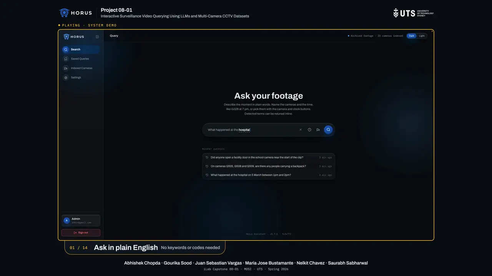
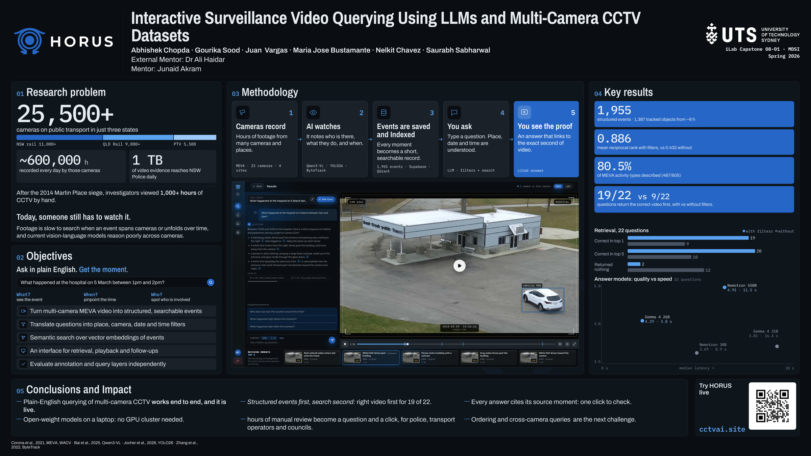

# Horus Assistant — CCTV Query Frontend


The web app for **Horus**, a system that lets you ask questions about multi-camera CCTV footage in plain English, for example _"What happened at the hospital on 5 March between 1pm and 2pm?"_. You get a written answer in which every sentence cites the moment it came from. Click a citation and the video jumps to that exact second, with the tracked people and vehicles outlined. This repository is the **frontend only**: it talks to the FastAPI backend, which runs the retrieval-augmented (RAG) layer over events extracted from the [MEVA](https://mevadata.org/) dataset by an open-weight vision-language annotation pipeline.

**Live:** [cctvai.site](https://cctvai.site)

---

## 🎬 Demo

### Video walkthrough

[](https://media.nelkit.dev/projects/demos/horus-demo-loop-4k-dark.mp4)

_48-second highlight: ask in plain English, fine-tune the detected filters, read a cited answer and jump to the exact second. Download it as [MP4 (1080p)](docs/media/demo/horus-demo-clip.mp4)._

[](https://media.nelkit.dev/projects/demos/horus-demo-loop-4k-dark.mp4)

### Showcase poster

[](docs/media/poster/poster-dark.png)

_Click the image to open the full-resolution poster (8164 × 4592)._

---

## Table of Contents

- [Overview](#-overview)
- [System Architecture](#️-system-architecture)
- [Local Setup](#-local-setup)
- [Environment Variables](#-environment-variables)
- [Usage / API](#-usage--api)
- [Testing](#-testing)
- [Scripts](#-scripts)
- [Deployment](#️-deployment)
- [Known Limitations](#️-known-limitations)
- [Team](#-team)
- [Links](#-links)

---

## 🧭 Overview

- **Subject:** 36105 iLab: Capstone Project — University of Technology Sydney, Spring 2026
- **Assessment:** Project 08-01 — _Interactive Surveillance Video Querying Using LLMs and Multi-Camera CCTV Datasets_
- **Scope of this repo:** the user-facing web app (landing page, sign-in, search, results workspace, assistant, saved queries, camera directory, settings)
- **Live demo:** [https://cctvai.site](https://cctvai.site)
- **Backend API docs:** [surveillance-backend-nodd.onrender.com/docs](https://surveillance-backend-nodd.onrender.com/docs)

A user signs in with Supabase Auth and types a question on the **Search** screen. As they type, the query field highlights the places, cameras, dates and times it recognises, so they can see which filters will apply before any model runs. The search streams its progress from the backend over Server-Sent Events. Results open in a workspace: a ranked list of matching moments, each with a confidence score, beside a video player. The assistant streams a formatted answer in which every claim cites an event. Clicking a citation or a moment seeks the player to that second and draws the tracked boxes over the video. The assistant then suggests follow-up questions, and any query can be saved and run again later. When the archive has no supporting events, the interface says so instead of inventing an answer.

**Key results of the full system** (from the final report, on 71 MEVA clips, about 5.9 hours from 23 cameras):

| Measure                                           | Result                               |
| ------------------------------------------------- | ------------------------------------ |
| Structured events extracted                       | 1,955 events, 1,387 tracked objects  |
| Events consistent with MEVA ground truth          | 96.4% (1,724 of 1,788)               |
| MEVA activity types described per clip            | 80.5% (487 of 605)                   |
| Correct video ranked first, with metadata filters | 19 of 22 questions (9 of 22 without) |

### Related repositories

The system is split across five repositories in the [uts-ilab-p08](https://github.com/uts-ilab-p08) organisation:

| Repository                                                                                 | Role                                                                                                      |
| ------------------------------------------------------------------------------------------ | --------------------------------------------------------------------------------------------------------- |
| **[cctv-query-frontend](https://github.com/uts-ilab-p08/cctv-query-frontend)** (this repo) | Next.js web app                                                                                           |
| [surveillance-backend](https://github.com/uts-ilab-p08/surveillance-backend)               | FastAPI service: session check, search and assistant endpoints, saved queries, video tracks, SSE progress |
| [iLabs-capstone-rag](https://github.com/uts-ilab-p08/iLabs-capstone-rag)                   | RAG layer: bge-base embeddings, Qdrant index, rule-based filters, cited answers                           |
| [videometa](https://github.com/uts-ilab-p08/videometa)                                     | Annotation library: VLM window filter, YOLO26 + ByteTrack tracking, VLM annotator                         |
| [video-annotation-pipeline](https://github.com/uts-ilab-p08/video-annotation-pipeline)     | Runs the annotation pipeline over the MEVA clips and evaluates it                                         |

---

## 🏗️ System Architecture

```text
                         ┌──────────────────────────────────────────────┐
                         │  cctv-query-frontend  (this repo, Vercel)    │
                         │  Next.js 15 App Router · React 19 · Zustand  │
   Browser  ───────────► │                                              │
                         │  /            landing (public)               │
                         │  /login       Supabase sign-in               │
                         │  /auth/guest  shared guest sign-in (QR)      │
                         │  /dashboard   search    /results  workspace  │
                         │  /saved  /cameras  /settings  /profile       │
                         │                                              │
                         │  middleware.ts → refresh session, guard app  │
                         │  src/lib/api   → apiFetch / apiStream (SSE)  │
                         └───────┬──────────────────────────┬───────────┘
                                 │ Supabase session         │ Bearer token
                                 ▼                          ▼
                    ┌────────────────────┐     ┌─────────────────────────────┐
                    │  Supabase Auth     │     │  surveillance-backend       │
                    │  (users, sessions) │     │  FastAPI /api/v1 (Render)   │
                    └────────────────────┘     │  session check · SSE stream │
                                               └──────┬───────────────┬──────┘
                                     in-process call  │               │ enrich
                                                      ▼               ▼
                                   ┌──────────────────────┐   ┌──────────────────────┐
                                   │  iLabs-capstone-rag  │   │  Event store         │
                                   │  filters → Qdrant →  │   │  Supabase PostgreSQL │
                                   │  LLM cited answer    │   │  events, tracks,     │
                                   │  (OpenRouter)        │   │  saved queries       │
                                   └──────────┬───────────┘   └──────────▲───────────┘
                                              │ indexes                  │ writes events
                                              ▼                          │
                                   ┌──────────────────────┐   ┌──────────┴───────────┐
                                   │  Qdrant (hosted)     │   │  videometa pipeline  │
                                   │  bge-base vectors    │   │  MEVA video → events │
                                   └──────────────────────┘   └──────────────────────┘

   Video files are served from Cloudflare R2; the player overlays the boxes from /videos/{id}/tracks.
```

**Inside this repo:**

| Path                  | Responsibility                                                                                                               |
| --------------------- | ---------------------------------------------------------------------------------------------------------------------------- |
| `src/app/`            | Routes (App Router). `(app)/` is the signed-in shell; `/`, `/login` and `/auth/*` are public.                                |
| `src/components/`     | UI by feature: `landing`, `login`, `query`, `results`, `assistant`, `saved`, `cameras`, `settings`, `layout`, `ui`, `brand`. |
| `src/lib/api/`        | The only place that calls the backend: `client.ts` (auth header, errors), `endpoints.ts`, `sse.ts`, `normalize.ts`.          |
| `src/lib/supabase/`   | Browser, server and middleware Supabase clients.                                                                             |
| `src/lib/`            | Pure, unit-tested helpers: entity highlighting, time parsing, citations, tracks, guest access.                               |
| `src/store/`          | Zustand store.                                                                                                               |
| `BACKEND_API_SPEC.md` | The API contract and pending-endpoints spec written for the backend team.                                                    |

---

## 🚀 Local Setup

### Before you start

| Requirement                                 | Why                                                                                                                                                |
| ------------------------------------------- | -------------------------------------------------------------------------------------------------------------------------------------------------- |
| Node.js 18.18+ (20 LTS recommended) and npm | Minimum for Next.js 15                                                                                                                             |
| A Supabase project (URL + anon key)         | Sign-in. Use the team's project, since the backend verifies the same sessions.                                                                     |
| A running backend                           | Search, assistant, clips and tracks. Use the live API or run [surveillance-backend](https://github.com/uts-ilab-p08/surveillance-backend) locally. |
| A user in that Supabase project             | Every app route except the landing redirects to `/login`.                                                                                          |

### Clone the repository

```bash
# SSH
git clone git@github.com:uts-ilab-p08/cctv-query-frontend.git

# HTTPS
git clone https://github.com/uts-ilab-p08/cctv-query-frontend.git

cd cctv-query-frontend
```

### Frontend

**Step 1 — Install dependencies** _(required)_

```bash
npm install
```

This also installs the Husky pre-commit hook (`prepare` script), which runs ESLint and Prettier on staged files.

**Step 2 — Create `.env.local`** _(required)_

See [Environment Variables](#-environment-variables). At minimum, set the Supabase URL and anon key and the API base URL.

**Step 3 — Start the dev server**

```bash
npm run dev
```

Open [http://localhost:3000](http://localhost:3000). The landing page is public. Sign in at `/login` to reach `/dashboard`.

> **Tip:** the live backend runs on Render's free plan, so the first request after a period of inactivity can take a while as the service wakes up.

---

## 🔐 Environment Variables

`.gitignore` excludes every `.env*` file, so a fresh clone has no template. Create `.env.local` in the project root:

```bash
# macOS / Linux
touch .env.local
```

```powershell
# Windows (PowerShell)
New-Item .env.local -ItemType File
```

### Required

| Variable                        | Description                                                                                                          |
| ------------------------------- | -------------------------------------------------------------------------------------------------------------------- |
| `NEXT_PUBLIC_SUPABASE_URL`      | Supabase project URL (`https://<project>.supabase.co`)                                                               |
| `NEXT_PUBLIC_SUPABASE_ANON_KEY` | Supabase anon (public) key                                                                                           |
| `NEXT_PUBLIC_API_BASE_URL`      | Backend base URL without `/api/v1`, e.g. `https://surveillance-backend-nodd.onrender.com` or `http://localhost:8000` |

### Optional (with defaults)

| Variable               | Default                   | Description                                                |
| ---------------------- | ------------------------- | ---------------------------------------------------------- |
| `NEXT_PUBLIC_SITE_URL` | `https://www.cctvai.site` | Canonical URL for metadata, `sitemap.xml` and `robots.txt` |

### Optional — guest access (server-only)

Guest access lets anyone holding one shared code sign in to a shared account until a fixed expiry. It was built for the showcase QR code, which points at `/?guest=<code>`. It is **off** unless all four variables are set and the expiry parses. None of them is `NEXT_PUBLIC_`, so they never reach the browser.

| Variable                  | Description                                                                                                  |
| ------------------------- | ------------------------------------------------------------------------------------------------------------ |
| `GUEST_ACCESS_CODE`       | The shared code                                                                                              |
| `GUEST_ACCESS_EXPIRES_AT` | ISO 8601 date-time with an offset, e.g. `2026-10-22T23:59:00+11:00`. Also ends the guest sessions it opened. |
| `GUEST_EMAIL`             | Supabase account that guests are signed in as                                                                |
| `GUEST_PASSWORD`          | That account's password                                                                                      |

### Not needed — set automatically at build time

| Variable                  | Source                                                                              |
| ------------------------- | ----------------------------------------------------------------------------------- |
| `NEXT_PUBLIC_APP_VERSION` | `package.json` → `version` (via `build-info.ts` and `next.config.ts`)               |
| `NEXT_PUBLIC_APP_COMMIT`  | `VERCEL_GIT_COMMIT_SHA`, `GITHUB_SHA` or `git rev-parse`, shortened to 7 characters |

---

## 💻 Usage / API

### App routes

| Route                   | Access    | Screen                                                                   |
| ----------------------- | --------- | ------------------------------------------------------------------------ |
| `/`                     | Public    | Landing page: problem, approach, results, team                           |
| `/login`                | Public    | Supabase email/password sign-in                                          |
| `/auth/guest?code=…`    | Public    | Signs in to the shared guest account, then opens `/dashboard`            |
| `/dashboard`            | Signed in | Search: query field with highlighted entities and recent queries         |
| `/results?q=…`          | Signed in | Results workspace: assistant, matching moments, video player with tracks |
| `/clips/[clipId]`       | Signed in | Clip detail                                                              |
| `/saved`                | Signed in | Saved queries, with _Run again_ and delete                               |
| `/cameras`              | Signed in | Indexed cameras directory                                                |
| `/settings`, `/profile` | Signed in | Theme, palette, about (version and commit), profile                      |

The query lives in `?q=`, so a refresh or a shared link re-runs the search.

### Backend endpoints used

All calls go through `src/lib/api/client.ts`, which adds `Authorization: Bearer <Supabase access token>`.

| Method              | Path                                                              | Used for                                                                     |
| ------------------- | ----------------------------------------------------------------- | ---------------------------------------------------------------------------- |
| GET                 | `/api/v1/search/stream` (fallback `/api/v1/search`)               | Search, streamed over SSE                                                    |
| POST                | `/api/v1/assistant/ask/stream` (fallback `/api/v1/assistant/ask`) | Cited assistant answer, streamed over SSE                                    |
| POST                | `/api/v1/assistant/suggestions`                                   | Follow-up question suggestions                                               |
| GET                 | `/api/v1/clips/{id}`                                              | Clip detail                                                                  |
| GET                 | `/api/v1/clips/{id}/related`                                      | Related clips                                                                |
| GET                 | `/api/v1/videos/{video_id}/tracks`                                | Tracked boxes drawn over the video                                           |
| GET                 | `/api/v1/cameras`                                                 | Camera directory                                                             |
| GET                 | `/api/v1/vocabulary`                                              | Places, cameras and dates for entity highlighting (cached in `localStorage`) |
| GET                 | `/api/v1/queries/recent`                                          | Recent queries                                                               |
| GET / POST / DELETE | `/api/v1/queries/saved`                                           | Saved queries                                                                |

The full contract is in [`BACKEND_API_SPEC.md`](BACKEND_API_SPEC.md).

---

## 🧪 Testing

Unit and component tests use Vitest, React Testing Library and jsdom. Test files sit next to the code they test (`*.test.ts` / `*.test.tsx`).

```bash
npm test             # single run
npm run test:watch   # watch mode
npm run lint         # ESLint
npm run format       # Prettier (with the Tailwind class-sorting plugin)
```

On commit, Husky runs `lint-staged`, which applies `eslint --fix` and `prettier --write` to staged files.

---

## 🔄 Scripts

### Releases

The version shown in **Settings → About** and in the footer is `package.json` → `version`, linked to the matching GitHub release. From a clean `main`:

```bash
npm run release:patch   # fixes            0.8.0 → 0.8.1
npm run release:minor   # new features     0.8.0 → 0.9.0
npm run release:major   # breaking changes 0.8.0 → 1.0.0
```

Each one bumps `package.json`, commits `chore(release): vX.Y.Z`, tags `vX.Y.Z` and pushes both.

When the bump goes through a pull request instead (`npm version <bump> --no-git-tag-version`), tag after it merges so the tag points at a commit on `main`:

```bash
git switch main && git pull
git tag "v$(node -p "require('./package.json').version")" && git push origin --tags
```

The tag triggers `.github/workflows/release.yml`, which checks that the tag matches `package.json` and creates the GitHub release with generated notes.

### Demo autopilot

`scripts/demo/horus-demo.mjs` drives the app through the showcase demo with Playwright and your installed Google Chrome, so the walkthrough only needs to be screen-recorded. It draws its own cursor with click ripples.

```bash
npm run demo:record                                   # full demo against https://cctvai.site
npm run demo:record -- --check                        # fast run; reports OK / MISSING per step
npm run demo:record -- --url http://localhost:3000    # against a local dev server
```

It keeps the browser session in `./.horus-chrome-profile`. **That folder holds login cookies: never commit it.**

---

## ☁️ Deployment

The frontend is deployed on **Vercel** and served at [cctvai.site](https://cctvai.site).

1. Import the repository in Vercel (framework preset: Next.js; build command `npm run build`).
2. Set the [required variables](#required) for Production, plus `NEXT_PUBLIC_SITE_URL` and the guest variables if needed.
3. Pushes to `main` deploy to production. `VERCEL_GIT_COMMIT_SHA` gives the build its commit, which the app shows next to the version.

The backend is deployed separately on Render. See [surveillance-backend](https://github.com/uts-ilab-p08/surveillance-backend).

---

## ⚠️ Known Limitations

- **No user study.** The interface design (cited answers, jump to the second, follow-ups) rests on design reasoning; it was not tested with investigators.
- **One camera at a time.** The pipeline analyses each camera independently, so one incident filmed by two cameras appears as two results, and counts can be inflated.
- **No ordering questions.** Questions such as _"after the van arrived"_ or sequences across cameras are not supported by the query layer.
- **MEVA only.** The data covers four site types, 23 cameras and two days in March 2018. Results elsewhere are unknown.
- **Prototype security.** Basic Supabase authentication; no audit log, retention policy or face/plate blurring. The guest account is shared by everyone who holds the code.
- **Free-tier hosting.** The backend can be slow on its first request after being idle.
- **Pipeline screen is a mock.** `/pipeline` (not in the sidebar) simulates annotation jobs locally; it is not connected to the annotation pipeline.

---

## 👥 Team

| Member                                                            | Primary contributions                                                                                                                                                         |
| ----------------------------------------------------------------- | ----------------------------------------------------------------------------------------------------------------------------------------------------------------------------- |
| [Abhishek Chopda](https://github.com/abychopda)                   | RAG Lead and retrieval/model evaluation: embeddings, Qdrant index, rule-based filters, cited-answer prompt, 30-question retrieval evaluation and four-model answer comparison |
| [Gourika Sood](https://github.com/gourika22)                      | Backend Lead: Postgres event store, FastAPI layer with in-process RAG, saved queries, video tracks, SSE progress, test suite covering all 14 endpoints                        |
| [Juan Sebastian Vargas](https://github.com/Sebas102507)           | Video Annotation Lead: annotation pipeline, Qwen3-VL activity gate, `videometa` library, coverage check and explorer                                                          |
| [Maria Jose Bustamante](https://github.com/mariajosebustamante99) | Evaluation Lead: MEVA reference data, event-to-MEVA matching, data audits, manual assessment form, human review analysis                                                      |
| [Nelkit Chavez](https://github.com/Nelkit)                        | Frontend Lead: design system, landing, login, search, results workspace and assistant, API contract, integration and Vercel deployment, showcase poster and demo video        |
| [Saurabh Sabharwal](https://github.com/finegoodok)                | Evaluation (Annotation QA): LLM-judge QA pipeline and rubric, temporal IoU evaluation, human-in-the-loop review                                                               |

**External Mentor:** Dr Ali Haidar · **Mentor:** Junaid Akram

---

## 🔗 Links

- Live app: [https://cctvai.site](https://cctvai.site)
- Backend API (OpenAPI docs): [https://surveillance-api.nelkit.dev/docs](https://surveillance-api.nelkit.dev/docs)
- GitHub organisation: [uts-ilab-p08](https://github.com/uts-ilab-p08)
- MEVA dataset: [mevadata.org](https://mevadata.org/)
- Releases: [github.com/uts-ilab-p08/cctv-query-frontend/releases](https://github.com/uts-ilab-p08/cctv-query-frontend/releases)

---

<p align="center">
  36105 iLab: Capstone Project | Master of Data Science and Innovation | University of Technology Sydney | Spring 2026
</p>
